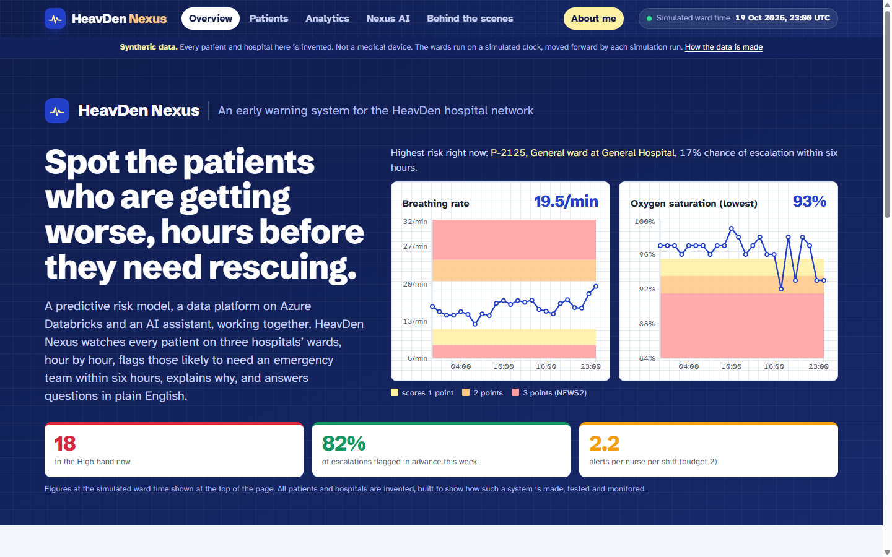
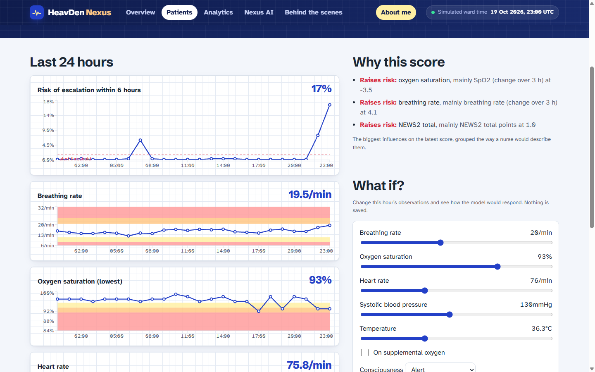
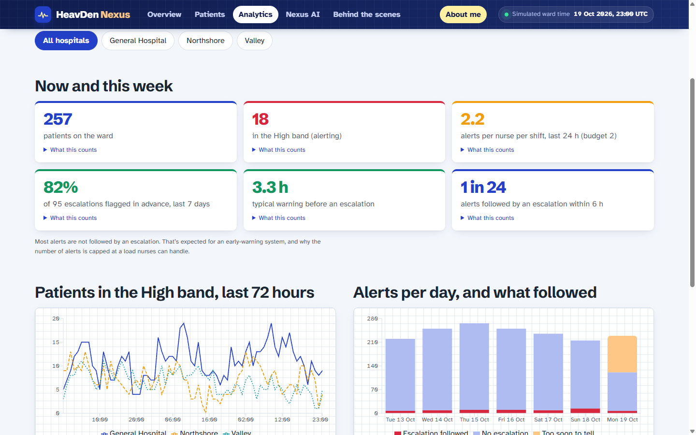
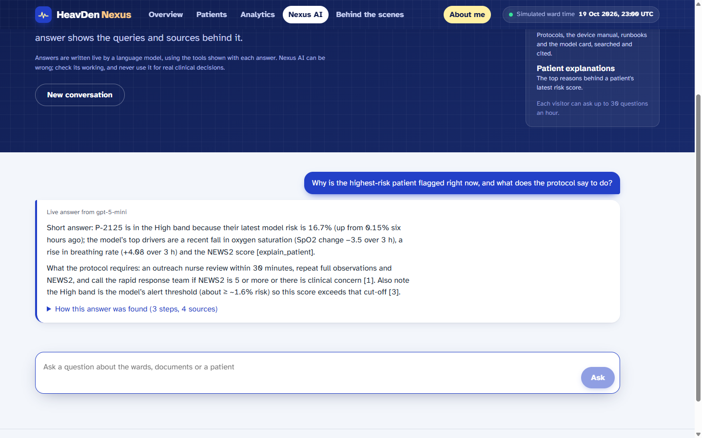
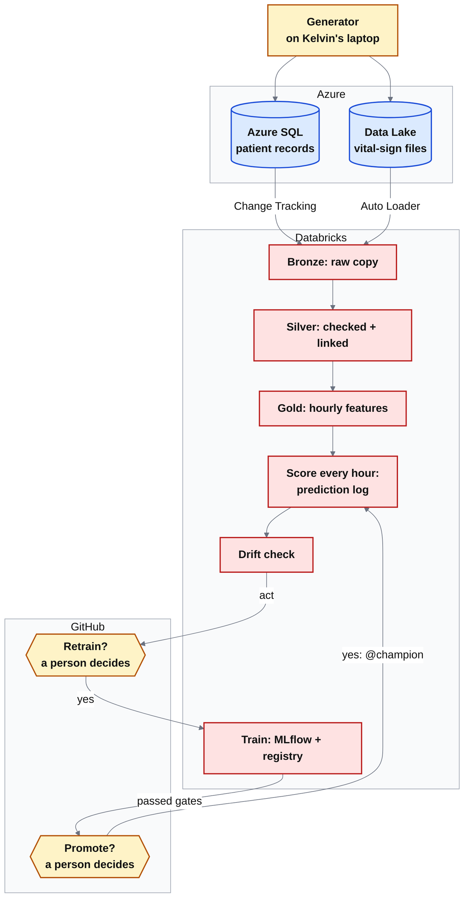
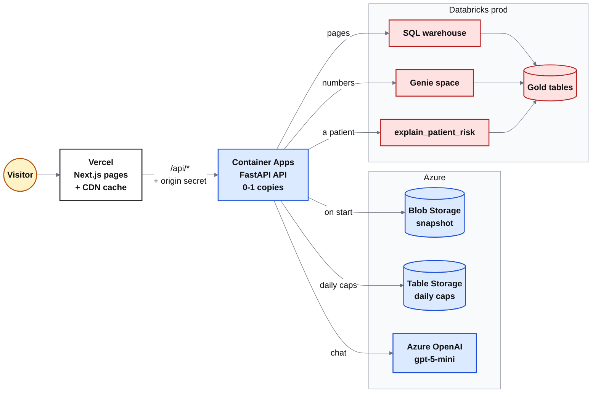

# HeavDen Nexus

**An early-warning system for hospital wards, built end to end: synthetic patients, a data platform, a risk model that has to beat the clinical standard, drift monitoring with human-approved retraining, an AI assistant, and a public web app.**

HeavDen Nexus watches every inpatient across three fictional hospitals, hour by hour. It estimates each patient's chance of needing an emergency team within the next six hours, raises a limited number of alerts a nurse can act on, explains each score in clinical terms, and answers questions about the wards in plain English, showing the queries and sources behind every answer.

> **Synthetic data only.** Every patient, hospital and document is invented. This is a portfolio project, not a medical device, and must not be used for real patient care.



## Where it stands

The project is built in phases. **Phases 0–5 are complete.** The data platform runs on Azure Databricks. The model is trained, registered, scored and monitored there, and has been retrained once after real drift with two human approvals. A private Databricks assistant answers questions about the wards. The public website reads production live. Every change goes through CI to staging. Databricks and the API reach production only from a release tag, after an approval; the website's pages go live when a change is merged. **Phase 6**, a low-cost steady state, is being built.

| Phase | Scope | Status |
|---|---|---|
| 0. Offline foundations | data generators, drift scenarios, features, model, evaluation, documents, API and web app in demo mode, learning notebooks, CI | **done** |
| 1. Data platform | Terraform, Azure SQL with Change Tracking and Auto Loader into Bronze, Silver and Gold pipelines with expectations, Unity Catalog; dev, staging and prod deployed from GitHub Actions with OIDC (no stored secrets) | **done** |
| 2. Model and scoring | training job with MLflow on Unity Catalog (`@champion` / `@challenger`), batch scoring into an append-only prediction log, a Clinical Ops AI/BI dashboard | **done** |
| 3. Monitoring and MLOps | PSI and Jensen-Shannon drift checks with Lakehouse Monitoring alongside, retraining and promotion approved in GitHub Actions, rollback, an audit table; three drift episodes run in production | **done** (16 Oct) |
| 4. Databricks assistant | Genie, document search and a Unity Catalog function behind one tool-calling assistant on Model Serving, traced in MLflow, red-teamed and quality-gated in CI | **done** (in production since 19 Oct); a Vector Search comparison is still to run |
| 5. Live website | FastAPI on Azure Container Apps reading production live, released from GitHub with approvals; Next.js on Vercel, published on merge | **done** (21 Oct) |
| 6. Maintenance mode | the website on a weekly snapshot, a weekly job that keeps the hospital running, budgets, nothing billed by the hour | being built (by 30 Oct) |

**New here?** [`docs/Phase-5-README.md`](docs/Phase-5-README.md) walks through the whole system step by step, from the synthetic hospital to a visitor's screen: where each part runs, how it works and why.

## What's in it

**Believable synthetic data** (`generator/`)
- Patients from [Synthea](https://github.com/synthetichealth/synthea), placed in three hospitals with 360 beds; about 300 are admitted at any time, with admissions, transfers and discharges driven by events.
- A vital-signs simulator that reports every 5 minutes from bedside devices, keeping a patient's true physiology separate from what the sensor measures (noise, artefacts, dropouts, stuck sensors).
- A hidden outcome rule decides who deteriorates and when; vital signs worsen in the hours before. Nurses titrate oxygen and record consciousness, as on a real ward. Outcomes arrive about 6 hours late, as labels do in practice.
- Four drift scenarios from one config file: an SpO2 sensor bias after a firmware update at one site (data drift), a respiratory outbreak (abrupt drift), a protocol change that lowers the escalation threshold (concept drift), and devices that change their payload (schema drift).

**A model that has to earn its place** (`databricks/src/heavden/ml/`)
- A calibrated classifier for P(escalation within 6 h), not an anomaly score. Logistic regression and LightGBM compete; the winner must beat a full 7-parameter **NEWS2**, the score UK hospitals use, on the same alert budget.
- Time-based splits with gaps, point-in-time features, and alerts counted as alerts (a patient entering the High band, with 6-hour re-alert suppression), not as patient-hours.
- Each score comes with its reasons: exact SHAP contributions, grouped the way a nurse would describe them ("oxygen saturation", "blood pressure").

**Monitoring with a human in the loop** (`databricks/src/heavden/monitoring/`, `.github/workflows/`)
- Every day of new data is checked against the data the model learned from: feature drift (PSI), prediction drift (Jensen-Shannon), alert load, and accuracy once the late labels arrive. Lakehouse Monitoring runs alongside and is cross-checked, but never decides.
- An "act" result opens a retrain request in GitHub Actions. A person approves or rejects it with a reason, which is recorded in an audit table. A retrained model must pass its gates, and its promotion waits for a second approval.

**An assistant that shows its working** (`backend/heavden_api/chat/`)
- One tool-calling loop with three tools: the ward's numbers, search over the hospital's documents (protocols, device manual, runbooks, model card) with citations, and a patient-risk lookup. On Databricks the numbers come from **Genie** and the patient lookup is a Unity Catalog function.
- Two deployments of the same loop: the **Databricks assistant** on Model Serving (private, traced in MLflow, red-teamed and quality-gated in CI), and the website's assistant inside its API.
- Prompt-injection and data-leak defences sit before, inside and after the model. When the model writes SQL itself (snapshot mode), the SQL is parsed, allow-listed and run in a locked, read-only sandbox. Answers stream as they are written and remember the conversation for follow-ups.

**A public website** (`web/`, `backend/`)
- Next.js on Vercel, and FastAPI in one container on Azure Container Apps that scales to zero. Until 31 October the API reads production's Gold tables live, through the SQL warehouse and Genie. After that it serves a weekly snapshot from Azure Blob Storage, so visitors never wake the cloud.
- Only the website can reach the API: it adds a secret header, and Vercel's CDN keeps page data for 5 minutes. Chat has a per-visitor limit and a daily cap, and the website may keep Databricks' SQL warehouse on for at most 2 hours a day (pages and chat together).

| | |
|---|---|
|  |  |
|  | |

## Results on Databricks (production model, synthetic test period)

The production model is `heavden_prod.ml.deterioration_risk` **version 3** (`@champion`, LightGBM). It replaced version 1 (logistic regression) after the hospital changed its escalation protocol on 6 October: the drift check saw the old model's accuracy fall, a retrain was approved, and version 3 passed its gates against version 1 before a second approval promoted it. (An earlier retrain, version 2, also passed its gates but was refused at promotion: it had been approved by mistake while only a day of new-protocol data existed, so it had never learned the new protocol.) It trained on everything up to 9 October (the faulty Site B sensor hours left out), was chosen on 9-11 October, and was scored **once** on 11-13 October, which it never saw. Every score gets the same alert budget: **at most about 2 alerts per nurse per 12-hour shift**.

| Test block: 11-13 Oct, 28 escalations | Version 3 | Version 1 | NEWS2 |
|---|---|---|---|
| Escalations flagged in the 6 hours before | **22 of 28 (79%)** | 20 of 28 (71%) | 17 of 28 (61%) |
| Alerts per nurse per shift | 2.15 | 2.10 | 1.79 |
| AUROC (hourly ranking) | **0.76** | 0.70 | 0.74 |
| AUPRC (hourly ranking) | 0.21 | 0.22 | 0.15 |

Within the same alert budget, version 3 warns about **2 more of the 28** deteriorating patients than version 1 and **5 more** than NEWS2; on 300 resamples of patient stays it flagged at least as many as version 1 in 89% (ties count, so this shows it is not worse) and ranked patients better (AUROC) in 97%, against limits fixed in code before the run. A lead of 2 in 28 is within noise, so the claim is "not worse at catching escalations, better at ranking", not "catches more". Its top-of-the-list precision (AUPRC) is the same as version 1's: the gain is further down the ranking, among patients the new protocol escalates earlier. Before the protocol change, version 1 flagged 23 of 26 escalations against NEWS2's 19 on its own test block (1-3 October). The validation figures used to pick a model aren't reported as results, because picking on them makes them flattering. Every number is logged in MLflow with the run; the model card (`docs/corpus/model-card.md`) is reissued for each promoted version, and a production release is refused while it describes another one.

## Rehearsal results (Phase 0, offline)

Before Databricks, the same code ran on a laptop. On a held-out test period of about 3 days (70 hours) with 28 escalations, with both scores limited to **at most 2 alerts per nurse per 12-hour shift**:

| | Model | NEWS2 |
|---|---|---|
| Escalations flagged in the 6 hours before | **25 of 28 (89%)** | 21 of 28 (75%) |
| Flagged at least 3 hours ahead | **19** | 12 |
| Alerts followed by an escalation | about 1 in 30 | about 1 in 30 |
| AUPRC (hourly ranking) | **0.40** | 0.22 |

The model flags 14 percentage points more deteriorating patients in advance (95% interval from an encounter-level bootstrap: +3 to +28). The data is synthetic, so these numbers show the method works, not how it would do in a real hospital; the model card (`docs/corpus/model-card.md`) covers performance by site, age, sex and COPD, and the known limitations.

## Architecture

As built at the end of Phase 5. Phase 0 built and tested each piece offline first: pandas reference implementations of the gold tables, a local MLflow registry, FAISS in place of Vector Search, and the app in demo mode. The step-by-step walkthrough is in [`docs/Phase-5-README.md`](docs/Phase-5-README.md).

**The data platform:** records go in, Databricks turns them into scored, monitored data, and a person decides every retrain and promotion.



**The website:** Vercel serves the pages; the API on Container Apps reads production's Gold live until 31 October (SQL warehouse for pages, Genie and the patient function for the chat), and takes its model, and from 1 November all its data, from the snapshot in Blob Storage.



Key decisions:
- **Serverless only and triggered runs**, to fit a $200, 30-day cloud credit. Dev and staging run only from CI, on small seeded data.
- **Batch scoring, no always-on serving endpoint.** Risk is needed hourly, not per request. An always-on endpoint would cost about $57 a month, and scale-to-zero has minutes-long cold starts. `gold.risk_scores` doubles as the prediction log for monitoring.
- **Model deployment is an alias move** (`@champion`), never Model Registry stages.
- **Retraining and promotion need a human approval in GitHub Actions environments**, so the approval history stays in the repo after the cloud workspace is gone.
- **No stored secrets for identities.** GitHub Actions signs in through OIDC, and the website's API through a managed identity. On the website's path the only secret is the header the website sends the API, generated by Terraform. The platform keeps two more: the Azure SQL admin login used by Databricks' connection to it, and the LLM keys of the Databricks assistant's AI Gateway endpoints.
- **The public website is not a Databricks App**, because those can't be public. It runs on Vercel and Azure Container Apps.

### How the plan changed in Phases 5 and 6, and why

The first plan put the API on Render with a copy of the data inside it, and the website's chat on the Databricks assistant. Measuring each part before going live changed that:

| Planned | Built | Why |
|---|---|---|
| API on Render | **Azure Container Apps**, scaling to zero, with the image on GitHub's registry | The API's process measured 550-760 MiB (resident memory on Linux), more than Render's 512 MB; inside its 1 GiB container it peaks at 550-660 MiB. Container Apps' free monthly grant covers about 100 awake hours. |
| A service principal with a secret | **A managed identity** with read-only grants | It leaves no secret to store, leak or rotate. |
| The data snapshot baked into the image | **The snapshot in Azure Blob Storage**, checked file by file at every start | A data refresh no longer needs a new image and a deploy. The site starts even if Databricks is off. |
| Chat limits in the API's memory | **A daily cap in Azure Table Storage**, which fails closed | Scaling to zero wiped an in-memory count, so a "daily" cap restarted at every wake-up. |
| Page queries limited only by caches | **A shared daily warehouse allowance**: 2 hours a day for pages and chat, then the snapshot | The warehouse bills while it is on. A trickle of uncached pages could keep it on all day, and a per-visitor limit can't cap that. |
| A Vercel rewrite to a public API | **Route handlers that add a secret header**, plus Vercel's CDN cache | Callers who skipped the website would skip its visitor limit and keep the SQL warehouse awake. |
| The website's chat on the Databricks assistant's endpoint | **The same loop inside the API** (Genie, the UC function, documents) | A sleeping endpoint takes minutes to wake and answers in 25-30 s. Keeping it awake costs about $57 a month. |
| Vector Search for documents | **FAISS + BM25 in the image**; Vector Search gets one measured comparison | Vector Search bills every hour it exists. |

**Phase 6 (being built, by 30 Oct): maintenance mode.**
- From 1 November the website serves everything from the weekly snapshot. In snapshot mode the chat's model writes DuckDB SQL on a locked copy of the data.
- A weekly job keeps the hospital running, exports the snapshot and runs a drift episode every third week.
- Budgets and alerts are set, and anything billed by the hour is deleted.
- The chat model will be re-tested: in snapshot mode the model writes the SQL itself, which is where a stronger model helps, so it passes the quality test and the red-team before any switch.

## Run it locally

Requirements: Python 3.12 with [uv](https://docs.astral.sh/uv/), Node 22, and Java 17+ for Synthea.

```bash
uv sync --all-groups --no-group serving   # every group but `serving` (the website image's ML library versions)
uv run nbstripout --install --attributes .gitattributes   # once per clone
```

1. **Generate the data and the model** by working through the notebooks in `notebooks/local/` (01 runs Synthea, 05 builds the features, 06 trains and registers the champion, 08 builds the document index). Everything is written to `data/`, which is git-ignored.
2. **Build the demo snapshot and start the API:**
   ```bash
   uv run python backend/scripts/build_demo_snapshot.py
   uv run uvicorn heavden_api.app:app --port 8000      # http://127.0.0.1:8000/docs
   ```
   For live assistant answers, put `OPENAI_API_KEY=...` in a `.env` file at the repo root (git-ignored). Without a key, the assistant replays recorded answers.
3. **Start the web app:**
   ```bash
   cd web
   npm install
   npm run dev                                         # http://localhost:3000
   ```

Checks, as CI runs them on every pull request:

```bash
uv run ruff check . && uv run ruff format --check .
uv run pytest
cd web && npm run typecheck && npm run build
```

CI also validates the Databricks bundle on every pull request, deploys to **staging** and runs the pipeline there on every merge to `main`, and deploys to **prod** for a `v*` release tag once Kelvin approves the run. The same release exports the website's snapshot, builds the API's image and smoke-tests the two together. Only after that does it push the image, point the website at the snapshot and deploy to Container Apps, after a second approval. GitHub signs in as one service principal per environment through OpenID Connect, so GitHub stores no Databricks or Azure credential ([`infra/terraform/identities.tf`](infra/terraform/identities.tf)). How code reaches Databricks, step by step: [`docs/how-code-reaches-databricks.md`](docs/how-code-reaches-databricks.md).

More detail: [`backend/README.md`](backend/README.md) (endpoints, assistant safety, configuration) and [`web/README.md`](web/README.md) (design).

## Learning notebooks

`notebooks/local/` walks through every step hands-on, importing the project's code rather than copying it, and each one ends with exercises.

| Notebook | Topic |
|---|---|
| 00 | setup and a tour of the repo |
| 01 | Synthea patients |
| 02 | the vital-signs simulator |
| 03, 03b | the hidden outcome rule; hospital activity and what an incremental load fetches |
| 04 | the drift scenarios |
| 05 | features and labels without leakage |
| 06 | NEWS2 and the first model |
| 07 | evaluation in depth: alert budgets, bootstrap intervals, fairness slices, explanations |
| 08 | the document corpus, chunking and retrieval |

## Repository layout

```
generator/              Synthea runner, hospital activity, vitals, outcomes, bedside care, drift episodes
databricks/             the bundle: jobs, pipeline, dashboards (databricks.yml, resources/)
  src/heavden/            Python package used locally and on Databricks:
    ingestion/, pipelines/  Azure SQL ingestion; Bronze, Silver and Gold logic
    ml/                     features, NEWS2, training, evaluation, explanations, scoring, model ops
    monitoring/             PSI and Jensen-Shannon drift, Lakehouse Monitoring integration
    agent/                  documents, retrieval, SQL guard, the Genie space, assistant publishing
backend/                FastAPI app (live and demo modes), its Dockerfile, scripts (export, smoke, red-team)
web/                    Next.js app
infra/terraform/        Azure and Databricks infrastructure, identities, the website's hosting
docs/                   step-by-step guide, how code reaches Databricks, quality runs, the documents
notebooks/              learning notebooks (local/, free) and Databricks notebooks
tests/                  unit tests
.github/workflows/      ci.yml (checks + staging), release.yml (prod + website), data runs, retrain, promote, rollback
```

## License

[MIT](LICENSE)
