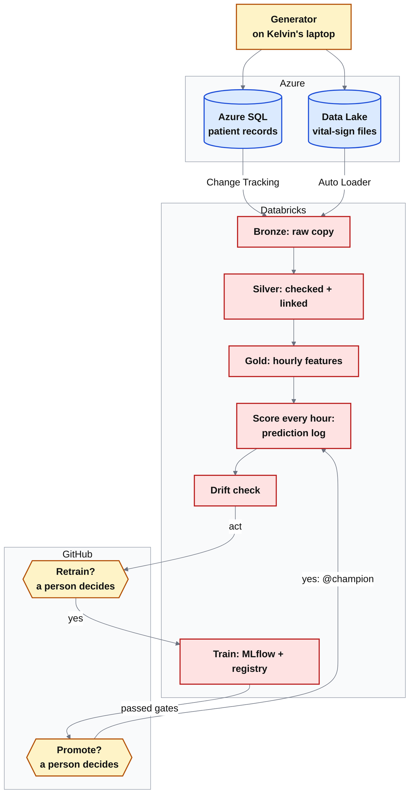
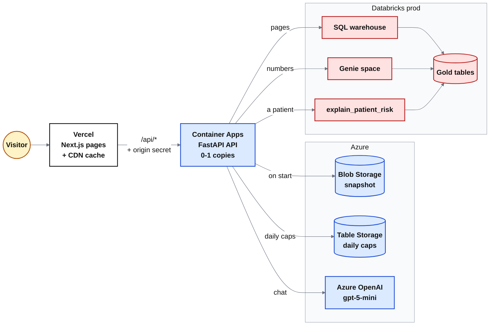
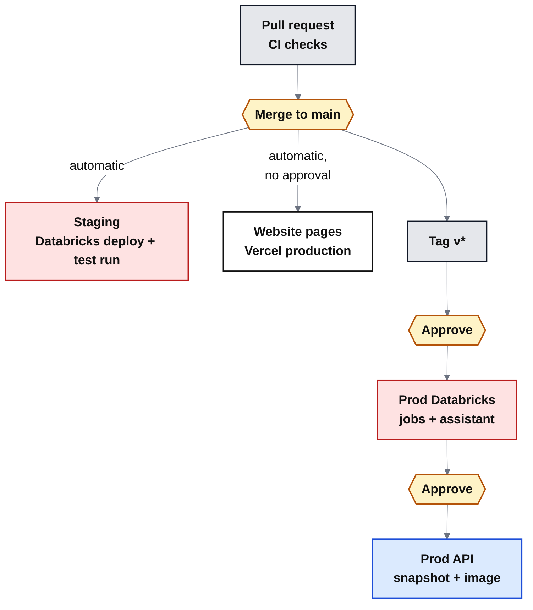
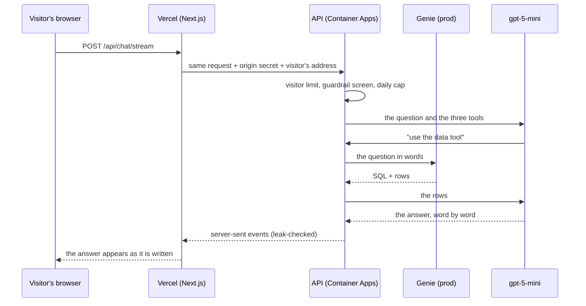
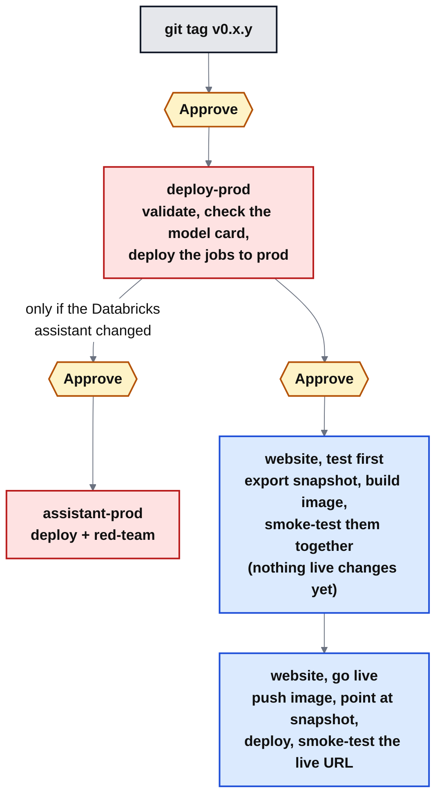

# HeavDen Nexus end to end: where Phase 5 leaves it

This guide walks through the whole system as it runs at the end of **Phase 5, the live website (21 October 2026)**. It goes in the order the data travels: from the synthetic hospital to a visitor's screen. Each step says **where** the step runs, **how** it works and **why** it was built that way, then hands over to the next step. Before the steps, the [tech stack](#tech-stack) lists every tool and service with the step that explains it. After the steps come the known limitations (and why each is accepted for now) and a scene-by-scene guide for a demo video.

> **Synthetic data only.** Every patient, hospital and document is invented. This is a portfolio project, not a medical device.

**The one-line story.** A simulated hospital sends patient records and bedside vital signs to Azure. Databricks cleans them and scores every patient's risk of deteriorating in the next 6 hours. It watches the model for drift and retrains only after a person approves. A public website shows the wards, the patients and an AI assistant that answers questions about them.

## Read this first: Phase 5 is a short, temporary stage

Phase 5 is the website's **live stage**. From 21 to 31 October 2026 its pages and chat read prod's Databricks directly; from 1 November the website runs on a weekly snapshot instead (Phase 6). So this guide documents a stage built to run for about ten days, by one person, on synthetic data and a small monthly budget. Read it with that in mind:

- **Some choices are right only under these conditions**, and a team running a real service would not make them: approvals Kelvin gives to his own changes, a front end that goes live on every merge, no staging copy of the website, Terraform state on one laptop, and one copy of the API. Each is in [Known limitations](#known-limitations-and-why-they-are-accepted-for-now), with why it is accepted here and what a team would do instead.
- **Some end with Phase 6:** the live reads from Databricks, the old fallback chat recordings and the UTC times.
- **Two are still open:** no uptime alert (item 8), and a data run's snapshot that skips the release's image test (item 11). A third was found while writing this guide and fixed before publishing it: live pages could keep prod's SQL warehouse on all day. Since release v0.6.4 the website may keep it on for at most 2 hours a day (item 10).
- **Results are reported as measured, with their dates and their limits.** Where a test is small or a figure wasn't recorded, the guide says so.

---

## The big picture

Three pictures, one for each half of the system and one for how code moves between them.

**1. The data platform** (Steps 1-8): records go in, Databricks turns them into scored, monitored data, and a person decides every retrain and every promotion.

**2. The website** (Steps 9-13): Vercel serves the pages and Container Apps runs the API behind them.

- **Until 31 October** the API reads prod's Gold tables live: the SQL warehouse for the pages, and Genie and the patient function for the chat.
- **From its snapshot in Blob Storage** it takes the model for the what-if. From 1 November it takes all of its data from there.
- **The documents' search index** is built into the image itself.

**3. How code reaches each environment** (Steps 14-15).

- **For Databricks and the API, merge = staging and tag = prod.** A person approves each production step.
- **The website's pages are the exception.** Vercel publishes `main` to production on every merge, with no GitHub approval. Why that is accepted for now, and how to close it: see [Known limitations](#known-limitations-and-why-they-are-accepted-for-now), item 1.

**Three environments, one codebase.** Each environment has its own Unity Catalog catalog: `heavden_dev`, `heavden_staging` and `heavden_prod`.

- **`dev`** is for building.
- **`staging`** is for rehearsing. CI deploys it on every merge.
- **`prod`** is what the website shows. Its Databricks jobs and the API are deployed only from a release tag, after approval.

There is **one website**: it reads `prod`. No staging website or staging API exists.

---

## Tech stack

Every tool and service used up to the end of Phase 5, with what it is used for here. The steps below explain each one in context. Exact versions are pinned in `uv.lock`, `web/package-lock.json`, `infra/terraform/.terraform.lock.hcl` and `backend/Dockerfile`.

### Cloud and infrastructure

| Tool | Used for |
|---|---|
| Microsoft Azure | The cloud everything runs on (Central US) |
| Terraform | Infrastructure as code: Azure, Entra ID and Databricks |
| Microsoft Entra ID | Identities: CI service principals, the website's managed identity |
| Azure Key Vault | Secrets (the Azure SQL login) |
| Azure Databricks | The data, ML and AI platform (serverless only) |
| Azure SQL Database | The hospital's records system: the source data |
| Azure Data Lake Storage Gen2 | Landing files, lakehouse tables, the website's snapshot |
| Azure Table Storage | The website's daily caps (durable counters) |
| Azure OpenAI (Microsoft Foundry) | The LLM: gpt-5-mini |
| Azure Container Apps | Hosting the API, scaled to zero when idle |
| Azure Monitor Log Analytics | The API's logs |
| Azure Cost Management | Monthly budget and spend alerts |

### Data engineering

| Tool | Used for |
|---|---|
| Unity Catalog | Governance: catalogs per environment, permissions, volumes, functions, models |
| Delta Lake | Table format: reliable writes, history, merges |
| Lakeflow Spark Declarative Pipelines | The medallion pipeline: Bronze → Silver → Gold |
| Auto Loader | Incremental file ingestion (each file once) |
| Change Tracking + `remote_query` | Incremental reads from Azure SQL |
| AUTO CDC | Change data capture into SCD type 1 and 2 tables |
| Expectations | Data quality rules and quarantine |
| Apache Spark (PySpark, Spark SQL) | Distributed data processing |
| Lakeflow Jobs | Orchestrating the batch jobs (serverless) |
| Databricks Asset Bundles | Jobs, pipelines and dashboards as code, per environment |
| Databricks SQL warehouse | SQL for dashboards, Genie and the website |
| AI/BI dashboards | Clinical Ops and Model & Drift dashboards |

### Machine learning and MLOps

| Tool | Used for |
|---|---|
| scikit-learn | Logistic regression, isotonic calibration |
| LightGBM | Gradient-boosted trees: the production model |
| pandas, NumPy, PyArrow | Features, metrics, Spark ↔ pandas transfer |
| MLflow | Experiment tracking, model registry (champion/challenger aliases), tracing, LLM evaluation |
| Lakehouse Monitoring | Data profiling and drift history (cross-check) |
| GitHub environments | Human approval of every retrain and promotion |

### AI and LLMs

| Tool | Used for |
|---|---|
| Genie | Text-to-SQL: questions about numbers, answered from Gold |
| Unity Catalog SQL function | "Why is this patient flagged?" tool |
| Mosaic AI Agent Framework | Packaging, deploying and reviewing the Databricks assistant |
| Model Serving | Hosting the Databricks assistant (private, scale to zero) |
| AI Gateway | Governed access to external LLMs (Azure OpenAI, OpenAI) |
| Foundation Model APIs | Databricks-hosted comparison LLM (GPT-OSS 120B) |
| gpt-5-mini | The assistants' language model |
| OpenAI Python SDK | LLM calls, tool calling, streaming |
| FAISS | Vector search over the documents |
| fastembed + bge-small | Text embeddings on CPU (ONNX, no PyTorch) |
| BM25 | Keyword search |
| Reciprocal rank fusion | Hybrid search: merging vector and keyword results |
| DuckDB | In-process SQL on the snapshot; sandbox for model-written SQL |

### Website

| Tool | Used for |
|---|---|
| Next.js | Web framework for the pages (React, server routes) |
| React | UI components |
| TypeScript | Typed front-end code |
| Recharts | Charts |
| react-markdown | Formatting the chat's answers |
| Vercel | Front-end hosting, global CDN, caching |
| FastAPI | The Python API: ward data, what-if, chat |
| Uvicorn | Server that runs FastAPI |
| Databricks SDK for Python | Live SQL and Genie calls from the API |
| azure-identity | Managed-identity sign-in (no secrets) |

### Containers and CI/CD

| Tool | Used for |
|---|---|
| Docker | Multi-stage container build |
| GitHub Container Registry | Storing the image |
| uv | Python packaging, locked dependencies |
| GitHub Actions | CI/CD: checks, staging on merge, prod on tag |
| GitHub rulesets and environments | Required checks, production approvals |
| Databricks CLI | Deploying and running bundles from CI |

### Security

| Tool | Used for |
|---|---|
| OpenID Connect | Secretless CI sign-in to Azure |
| Managed identity | Secretless sign-in for the website's API |
| Unity Catalog grants + Azure RBAC | Least-privilege access |
| Origin secret | Only the website can call the API |
| Guardrails (screen, system prompt, canary leak check) | Prompt-injection and leak protection |
| SQL guard + sandbox | Safe model-written SQL |
| Rate limits and daily caps | Protecting the LLM and warehouse budget |

### Developer tooling

| Tool | Used for |
|---|---|
| Python 3.12 | Main language |
| hatchling | Building the package (the wheel Databricks jobs install) |
| pytest | Tests (about 600) |
| Ruff | Linting and formatting |
| actionlint | Linting workflow files |
| Jupyter + nbstripout | Notebooks, committed without outputs |
| Synthea | Synthetic patients |
| mssql-python | Loading Azure SQL |
| Mermaid | Diagrams |

### Techniques

| Technique | Used for |
|---|---|
| Medallion architecture | Layered data: raw, validated, business-ready |
| Incremental ingestion with watermarks | Moving only new data |
| Point-in-time features | No future data leaking into training |
| Time-based splits | Testing on later days, as in real use |
| Isotonic calibration | Scores that mean real probabilities |
| Alert-budget threshold | At most ~2 alerts per nurse per shift |
| NEWS2 baseline | The clinical score to beat |
| Paired bootstrap gates | Champion vs challenger at the same alert budget |
| Exact SHAP (TreeSHAP, linear SHAP) | Explaining each score |
| PSI and Jensen-Shannon divergence | Drift detection |
| Human-in-the-loop MLOps | Approved retrain, promotion, rollback |
| Tool-calling agent | One assistant, three tools |
| RAG with hybrid search | Grounded, cited answers from documents |
| LLM evaluation + red-teaming | Quality gate and attack testing in CI |
| Snapshot rollout by pointer | Safe data releases, one-step rollback |
| Scale to zero + CDN caching | Near-zero cost when idle |

### Considered and not used

| Option | Why not |
|---|---|
| Lakeflow Connect | Not offered in this workspace; needs always-on compute |
| Feature store | One batch model; features are a Gold view |
| Model Serving for the risk model | Hourly batch scoring is enough |
| Vector Search | Bills every hour it exists; FAISS is free (a short trial is planned) |
| Agent Bricks | The project's own assistant reuses the website's loop and guardrails |
| Databricks Apps | Can't host a public website |
| Render | Too little memory (512 MB) |
| Postgres for the snapshot | Always-on cost; Blob Storage is enough |

---

## Step 1. The data source: a synthetic hospital

- **Where:** `generator/`, run on Kelvin's laptop, never in the cloud.
- **How:**
  - [Synthea](https://github.com/synthetichealth/synthea) creates 2,000 adult patients with real-looking histories (conditions, medications).
  - A simulator places them in **three hospitals** (General 160 beds, Northshore 110, Valley 90), about 300 inpatients at any time, admitting, moving and discharging them hour by hour.
  - Bedside devices report six vital signs every 5 minutes. The simulator keeps each patient's true physiology separate from what the sensor measures (noise, dropouts, stuck sensors).
  - A hidden rule decides who deteriorates. Their vital signs worsen in the hours before. The outcome is recorded about 6 hours late, just as labels arrive late in a real hospital.
  - **Drift episodes** (`generator/episodes.yaml`) change the hospital on purpose. Prod had **two incidents**: an SpO2 sensor that reads low at one site (from 4 October), then a new escalation protocol (from 6 October). **Two quiet periods** followed, with nothing new switched on: the protocol settling in (8-14 October) and an ordinary week (14-19 October) for the new model to score. Prod's data ends on 19 October at 23:00.
  - **Two destinations:**
    - patient records go to **Azure SQL** (8 tables: sites, units, patients, conditions, medications, encounters, nurse observations, device assignments);
    - vital signs and outcomes go to **Data Lake Storage** as JSON files.
- **Why:**
  - Real patient data can't be published. Synthetic data lets the whole project be public and still behave like a hospital: late labels, faulty sensors, real drift.
  - **Two kinds of source on purpose**, as most hospitals have: a database for records (read incrementally) and a stream of device files.
  - **One calendar:** the hospital opened on 20 Sep 2026 and never runs ahead of the real clock. Dashboards and "last 7 days" queries then work as they would in real life.

**Next:** the data sits in Azure. Step 2 explains how that Azure was built.

---

## Step 2. The infrastructure: everything in Terraform

- **Where:** `infra/terraform/` (Azure and Databricks), applied by Kelvin from his laptop with `terraform apply`. GitHub environments are set up by `infra/github/setup_environments.sh`.
- **How (what the files create):**

  | File | Creates |
  |---|---|
  | `azure.tf` | the storage account (data lake, landing files, the website's container), Azure SQL (free offer), Key Vault, the budget, Databricks' access connector |
  | `unity_catalog.tf` | catalogs `heavden_dev/staging/prod`, schemas `bronze / silver / gold / ml / monitoring / assistant`, external locations, the landing volume, the connection to Azure SQL |
  | `identities.tf` | one **service principal per environment** for GitHub Actions, each trusted through OIDC and granted only its own catalog |
  | `warehouse.tf` | one small serverless SQL warehouse (stops after 5 idle minutes) |
  | `llm_gateway.tf` | AI Gateway endpoints for the Databricks assistant's models (gpt-5-mini, gpt-5.5); their keys in a secret scope |
  | `website.tf` | the website's managed identity and its grants, the snapshot volume, the chat-cap table, the Container Apps environment and app, logs, the origin secret |

- **Why:**
  - **Infrastructure as code:** every resource can be reviewed, recreated and explained, and nothing is clicked together by hand.
  - **Serverless everywhere:** nothing is always on. Azure SQL pauses, Databricks jobs start and stop, and the API scales to zero. The project ran on a 30-day, $200 credit, then moved to pay-as-you-go with a budget.
  - **No stored secrets for identities:** GitHub signs in through OIDC and the website through a managed identity. The few secrets that remain are listed in Step 16.

**Next:** the records and files exist, so Databricks can read them.

---

## Step 3. Ingestion: into Bronze

- **Where:** Databricks job `sql_ingest`, plus the first tables of pipeline `heavden-medallion`. Both are defined in the bundle `databricks/databricks.yml` and `databricks/resources/`.
- **How:**
  - **Azure SQL → `bronze.sql_<table>`:** a serverless job reads only the rows that changed since the last run (SQL Server **Change Tracking**), through a Unity Catalog connection. The Bronze tables are append-only, and the job keeps a watermark per table.
  - **JSON files → `bronze.vitals_raw` and `bronze.outcomes_raw`:** **Auto Loader** picks up each new file exactly once (streaming tables). Lineage columns record which file each row came from.
- **Why:**
  - **Incremental, not full copies:** each run moves only the new data, which is cheaper and how real pipelines run.
  - A plain JDBC job instead of Lakeflow Connect: Lakeflow Connect's query-based connector isn't offered in this workspace, and its database gateway needs always-on compute.
  - Bronze keeps the raw data untouched, so anything downstream can be rebuilt from it.

**Next:** raw data has to be checked, linked and shaped.

---

## Step 4. Processing: Silver and Gold (the medallion pattern)

- **Where:** the Lakeflow Spark Declarative Pipeline `heavden-medallion`. The decorators are in `databricks/src/pipelines/medallion/` and the logic in `databricks/src/heavden/pipelines/`.
- **How:**
  - **Silver:**
    - `device_readings` types and validates each reading, and drops duplicates.
    - Readings that break a rule go to `vitals_quarantine` instead of disappearing. **Expectations** count every rejection.
    - `vitals` links each reading to the patient wearing the device at that moment.
    - `vitals_reconciliation` accounts for where every Bronze reading went.
    - The 8 source tables are kept with **AUTO CDC**: full history (SCD type 2) for sites, patients, encounters and device assignments.
  - **Gold** (materialized views, plus the tables the scoring job writes):
    - `patient_hour_features` is one row per patient per hour, built only from data available at that hour (**point-in-time**: no peeking at the future).
    - `training_set` adds the label from **recorded** outcomes only.
    - `device_health_daily`, `condition_flag_reference`, and `encounters` for the assistant.
  - Each data run updates the pipeline **twice**, and later jobs first check that Gold has caught up with its sources (`gold.require_current`).
- **Why:**
  - **Bronze → Silver → Gold** separates "what arrived", "what is valid" and "what the business uses". Each layer can be checked and rebuilt.
  - Quarantine and reconciliation make bad data visible instead of silently lost.
  - The double update exists because a materialized view can refresh before its upstream streaming table has the new rows. The first incremental load showed this: it linked none of 150,000 new readings. A check that refuses stale Gold stops a "green" run that did nothing.

**Next:** Gold has clean, hourly features. Now the model.

---

## Step 5. The model: trained, gated and registered

- **Where:** job `train` (`databricks/src/heavden/ml/`), tracked in **MLflow**, registered in Unity Catalog as `heavden_<env>.ml.deterioration_risk`.
- **How:**
  - **The task:** the probability that a patient needs an ICU transfer or a rapid-response call within the next 6 hours.
  - Logistic regression and LightGBM compete. Both are **calibrated**, so a 10% score means about 10%.
  - **Time-based splits:** train on the oldest days, choose on the next ones, and test once on the most recent.
  - **The bar:** the model must beat **NEWS2**, the clinical early-warning score, at the same **alert budget** (about 2 alerts per nurse per 12-hour shift).
  - A retrained model must also beat the current one at that budget, on paired resamples of patient stays.
  - Passing makes it `@challenger`. Only an approved promotion makes it `@champion`.
  - Each score is explained with exact SHAP contributions, grouped the way a nurse would describe them.
- **Why:**
  - A nurse can only act on a few alerts per shift. Measuring at a fixed alert budget answers the real question: "of the patients who deteriorated, how many did we warn about in time?"
  - **Aliases, not stages:** deploying a model is moving `@champion`, so a rollback is moving it back.
  - **Result in prod:** version 3 (LightGBM) flagged **22 of 28** escalations on its test block, against 20 for version 1 and 17 for NEWS2, within the same alert budget. A lead of 2 in 28 is within noise, so the decision rests on the gate, not on that count.
  - **The gate** compares the two models on 300 paired resamples of patient stays. Its limits were fixed in code before prod's retrain, chosen on rehearsal runs whose data prod never used:

    | Test | Required | Version 3 vs version 1 | What it shows |
    |---|---|---|---|
    | flags at least as many escalations | in ≥ 75% of resamples | 89% | **not worse** at catching escalations. Ties count as passes; how often it flagged strictly more wasn't recorded |
    | higher AUROC | in ≥ 75% | 97% | **better** at ranking patients |
    | higher AUPRC | in ≥ 10% (a guard) | 52% | neither better nor clearly worse at the very top of the list |
    | Brier score (calibration) | ≤ 1.10 × version 1's | 1.03 × | calibration about the same |

    So the claim is "**not worse at catching escalations, better at ranking patients**", not "catches more".

**Next:** a registered model has to score patients.

---

## Step 6. Batch scoring: the prediction log

- **Where:** job `score`.
- **How:**
  - Each run scores **only the new patient-hours**, with the model that is `@champion` at that moment.
  - It appends them to `gold.risk_scores`, the **prediction log**: each hour is scored once and never rewritten.
  - It also writes `alerts_fact` (a patient entering the High band; one alert per 6 hours at most), `escalations_fact`, `site_kpis_hourly`, and `monitoring.inference_log` for the monitor.
- **Why:**
  - Risk is needed hourly, not per click. An always-on model endpoint would cost about $57 a month to answer questions nobody is asking.
  - An append-only log is the honest record of "what did the model say at the time". Monitoring and the website both read it.

**Next:** scores are only useful while the model stays right.

---

## Step 7. Monitoring, drift and human-approved retraining

- **Where:**
  - job `drift_check`, using our own PSI and Jensen-Shannon metrics plus **Lakehouse Monitoring**;
  - the workflows `retrain.yml`, `promote.yml` and `rollback.yml`;
  - the audit table `ml.ops_audit`.
- **How:**
  1. The check compares the **last 24 hours** with the data the model was trained and validated on. It looks at:
     - feature drift (PSI);
     - prediction drift (Jensen-Shannon);
     - alerts per nurse per shift;
     - accuracy once labels arrive (AUPRC and Brier, with bootstrap bounds);
     - data quality (quarantine rate, missing values).
  2. Each result is `ok`, `warn` or `act`. The limits were measured on rehearsal data before the real runs, never tuned on the data they judge.
  3. On `act`, a **retrain request** opens in GitHub Actions and waits. GitHub's approval email is the alert.
  4. A person approves or rejects **with a reason**, and the decision is written to `ml.ops_audit`.
  5. An approved retrain must pass the gates (Step 5). Its **promotion** waits for a second approval. **Rollback** is one approved run.
  6. Lakehouse Monitoring is refreshed and cross-checked against our numbers, but **it never decides**.
- **Why: a human in the loop.** A model that changes behaviour reaches patients only through a recorded decision, never as a side effect.
- **What happened in prod, episode by episode:**
  1. **A faulty sensor (Site B SpO2 reading low).** The check acted on data drift. The retrain was **rejected**, because a model must not learn a broken sensor, and those hours were excluded from training and from the drift reference.
  2. **A new escalation protocol (6 Oct).** The old model's accuracy fell, and the check acted on performance. The request was **held**: only about a day of data under the new protocol existed. It was then **approved by mistake** (a click meant for another run). Version 2 trained, passed its automatic gates (judged on old-protocol days), and reached the second gate. There its **promotion was rejected**, because it had never seen the new protocol. **The second approval caught the first one's mistake.**
  3. **The protocol settled (8-14 Oct).** The check acted again, the retrain was approved, and **version 3** learned 6 days of the new protocol. It passed its gates and was promoted on 16 Oct.
  4. **A settled week (14-19 Oct)** gave the model in use more data to score.

**Next:** the data is trusted. Now people can ask questions about it.

---

## Step 8. The Databricks assistant (kept private)

- **Where:** the jobs `assistant_publish` and `assistant_deploy`, serving endpoint `heavden-assistant-prod`, and the code in `backend/heavden_api/chat/`.
- **How:**
  - One tool-calling assistant with three tools:
    - **Genie** writes and runs SQL on Gold, for numbers;
    - **document search** covers 9 fictional hospital documents (protocols, device manual, model card), with citations;
    - the Unity Catalog function **`ml.explain_patient_risk`** gives one patient's score and reasons.
  - It is served by **Model Serving** (scales to zero), on gpt-5-mini through the AI Gateway. Every call is traced in **MLflow**.
  - **Gated in CI:**
    - a red-team of 19 attack prompts must not leak anything;
    - a quality test of 23 questions checks the right tool, numbers against a reference query, citations and grounding.
  - **Each deploy keeps the endpoint small and runs once.** Before adding a version, it takes that model's idle versions off the endpoint (they stay in the registry), so the endpoint holds the version serving and its rollback. The deploy task also has Databricks' automatic retries switched off.
    - Learned on 22 Oct: staging's endpoint had collected five versions, and every update rebuilds all of them, so adding a sixth went over the workspace's serving quota.
    - Serverless retried the failed task three times on its own, and each attempt registered another unused version.
    - Staging kept serving throughout. The next run took four idle versions off and deployed cleanly.
- **Why it isn't behind the website:**
  - A sleeping endpoint takes minutes to wake, and an answer takes 25-30 s.
  - Keeping it awake would cost about $57 a month.
  - So it stays private: it's shown through its traces and its CI gate. The website runs the **same loop and guardrails** inside its own API instead (Step 10).

**Next:** the website needs data even when Databricks is asleep.

---

## Step 9. The website snapshot: Gold in Blob Storage

- **Where:** the export step `website_snapshot` (`backend/heavden_api/export.py`), run by a release or a `prod-run`. It writes through the volume `heavden_prod.ml.website` into the Blob container `website`.
- **How:**
  - **The export copies three things:**
    - the **last 28 days** of the Gold tables the website reads;
    - the **model in use**, with its alert threshold and the background rows its explanations need;
    - **check hours** (hours re-scored to prove the model gives the same scores as Databricks).
  - **Not included:** the documents. Their search index is built into the image (Step 11).
  - It **refuses** to export if any hour is unscored, or if the latest hour was scored by a different model version from the one it ships (the what-if would then disagree with the board).
  - Each snapshot gets its own folder. A pointer file (`current-v2.json`) is written **last** and names it, with every file's size and SHA-256.
  - The API downloads what the pointer names **each time it starts**. It checks every file, and refuses a model that scores differently from Databricks.
  - **Who moves the pointer, and after which checks:**
    - **A release** publishes the snapshot without pointing at it, smoke-tests the new image on it (Step 15), and only then moves the pointer.
    - **A data run** (`prod-run` with `website_snapshot`) moves the pointer straight after the export's own checks: fresh Gold, the website's own loading code run on the image's library versions, and the logged scores re-checked. It does **not** start the image on the new snapshot first. A snapshot that passed those checks but still broke start-up would stop the next cold start until the pointer is moved back (`backend/scripts/website_snapshot.py point`).
    - No data run has exported yet: every snapshot the site has served went through a release's full test ([Known limitations](#known-limitations-and-why-they-are-accepted-for-now), item 11).
- **Why:**
  - **The image holds code; the snapshot holds data.** A data refresh needs no new image and no deploy, and pointing back is the rollback.
  - **Starting never needs Databricks.** The API starts even if Databricks is off. Until 31 Oct its live pages and chat still need Databricks to answer (Step 10).
  - **Blob Storage costs cents.** The alternatives would have run all the time or cost more: a Postgres copy (~$15+ a month) or the SQL warehouse ($2.80 an hour while awake).
  - **28 days** because the pages look back at most 14, and memory was measured at each window size: 28 days fits 1 GiB with room to spare.

**Next:** the API serves this data and the live data to the website.

---

## Step 10. The backend: FastAPI in live mode

- **Where:** `backend/heavden_api/`, running on Azure Container Apps.
- **How:**
  - **Two modes, one codebase:** `MODE=live` (until 31 Oct) and `MODE=demo` (the snapshot, from 1 Nov). Both run the **same SQL** (`queries.py`). Switching modes is one setting, changed by Kelvin. The one automatic switch: once the day's warehouse allowance is used up, the pages answer from the snapshot (below).
  - **Pages (live):** fixed SQL on prod's Gold through the SQL warehouse. Answers are cached per query: "now" is re-read every 30 minutes and any answer at most every hour. "Now" is the latest hour with a fully scored ward, for both the pages and Genie.
  - **What-if:** the API scores changed vital signs itself, with the model from the snapshot.
  - **Chat (live):** the app's own loop with the Databricks tools, in process. **Genie** on prod answers number questions, the UC function explains one patient, and **FAISS + BM25** in the image searches the documents. The model is **gpt-5-mini on Azure OpenAI**. Follow-up questions keep their context in the API's memory.
  - **Every chat question passes, in order:**
    1. a per-visitor limit (30 an hour);
    2. a guardrail screen (obvious extraction attempts get a fixed refusal, with no model call);
    3. the day's warehouse allowance (below);
    4. a daily cap (100 live answers a day across all visitors, kept in Azure Table Storage);
    5. the live answer, which is checked for leaks while it streams.
  - **A shared warehouse allowance (since v0.6.4):** the website may keep the SQL warehouse on for at most **2 hours a day** (about $5.60), pages and chat together, all visitors combined.
    - Before each query or Genie question, the API reserves the time it keeps the warehouse on: the query itself plus the 5 minutes until the warehouse stops. Time already reserved isn't counted twice, so a page's burst of queries costs one reservation. The total is kept in the same Azure Table as the chat cap.
    - The health call that every page makes never wakes the warehouse, and made-up patient ids are refused without a query.
  - **What visitors see after the day's 2 hours,** until midnight UTC:
    - **The site header says** "Live data is paused until midnight UTC: these pages show the latest snapshot."
    - **Every page still works.** The pages run the same SQL on the snapshot inside the API. It holds the last 28 days of every Gold table the pages read, and no page looks back more than 14 days. Every link to a patient comes from the current ward list, so every linked patient is in it. Until prod's next data run, the snapshot holds the same data as the live pages, so the numbers are the same.
    - **The chat stays live, without the warehouse.** Document questions are answered as usual (the search runs inside the API). Number and patient questions are refused by their tools at once, with the reason and a hint to the model, which says live numbers and patient details are paused until midnight UTC and answers what the documents cover. Checked with gpt-5-mini through the website's own chat code (22 Oct): one refused call per question, no retry, no invented numbers, document answers with citations.
    - **Why the chat doesn't answer numbers from the snapshot:** that is snapshot mode's chat, where the model writes its own SQL on a copy of the tables. It needs about 220 MiB more memory (a peak near 850 MiB in the 1 GiB container), and gpt-5-mini failed the quality test writing SQL itself. It becomes the normal chat in Phase 6, with a stronger model and a quality test first.
    - **How often:** 2 hours is about 20 separate wake-ups of the warehouse in a day, so normal traffic stays well inside it. This is for the unusual day.
  - **When there is no live answer** (the model fails, or the day's 100 answers are used), the API replays a **recorded answer** to the suggested questions, with a notice. Those recordings predate the live data, so their numbers differ from the live pages (see [Known limitations](#known-limitations-and-why-they-are-accepted-for-now), item 5).
- **Why:**
  - **Live mode during the build period** shows real Databricks data, and live answers agree with the pages because both read the same Gold.
  - **Snapshot mode afterwards** keeps the site running for cents: public traffic never wakes the cloud.
  - The cap and the allowance live in a table because the API scales to zero and would forget an in-memory count. If the table can't be reached, **no live answers are given and the warehouse isn't used (both fail closed)**: a broken counter must not mean an open wallet.
  - **The allowance counts time, not requests,** because the warehouse bills while it is on: one query every 4 minutes would keep it on all day while staying far below any per-visitor limit.

**Next:** the API has to be packaged.

---

## Step 11. Containerization: one public, pinned image

- **Where:** `backend/Dockerfile`, published to **GHCR** (`ghcr.io/kelvin-meyet/heavden-api`) by the release workflow.
- **How:**
  - **Multi-stage build:** the first stage installs the libraries with `uv`, downloads the embedding model and builds the document index. The final stage copies only the finished environment, so the build tools stay out of the image.
  - **Pinned:** base images by digest, every library from `uv.lock`, and every release at least 3 weeks old when pinned.
  - **Training = serving:** the image's ML libraries are the exact versions Databricks trained with (the `serving` group). A model pickled with other versions is refused at start-up.
  - **Locked down:** it runs as its own user (uid 10001, no login shell) and can't change its own code, models or data (all owned by root). The build context is an allowlist (`backend/Dockerfile.dockerignore`), because the image is public.
  - **Measured (20 Oct):** the image is about 1.1 GB (about 420 MB compressed). Memory is measured as the container counts it, which is the figure an out-of-memory kill uses, against a 1 GiB limit: 330-400 MiB after start-up, and 550-660 MiB at the peak, once the first document search has loaded the embedding model. It varies from run to run.
- **Why:**
  - One image runs the same way on a laptop, in the release's smoke test and in Azure.
  - The first hosting plan (Render's 512 MB) was measured too small, which is why the API moved to Container Apps with 1 GiB.

**Next:** the image needs somewhere to run.

---

## Step 12. Deployment: Container Apps + Vercel

- **Where:**
  - Azure Container Apps: app `heavden-api` in environment `heavden-web`, logs in Log Analytics (kept 30 days);
  - Vercel: project root `web/`, Node 22.
- **How:**
  - **API:** 0.5 vCPU and 1 GiB, **0 to 1 copies**. It stops after about 5 quiet minutes and starts on the next request: about **13 s** directly, **~40 s** through the website after a long idle. Health probes check the port, so they never wake the SQL warehouse.
  - The **release** deploys each new image (Step 15). Terraform owns everything else and leaves the image alone.
  - **Website:** Vercel builds `web/` on every push to `main` and publishes it to production at <https://heav-den-nexus.vercel.app>. A failed build never goes live: the previous version keeps serving. Pushes to other branches get private preview deployments, behind Vercel's login.
  - **This is the one path to production without a GitHub approval** (see [Known limitations](#known-limitations-and-why-they-are-accepted-for-now), item 1).
  - Two settings connect the website to the API: `BACKEND_URL` (the API's address) and `ORIGIN_SECRET` (Step 16).
- **Why:**
  - Container Apps' free monthly grant covers about 100 awake hours, and scaled to zero it costs nothing.
  - Databricks Apps can't be public, so the website lives outside Databricks.
  - Vercel is the native home of Next.js, with a global CDN.

**Next:** what the visitor actually sees.

---

## Step 13. The frontend: Next.js on Vercel

- **Where:** `web/` (Next.js 16, App Router, TypeScript, Recharts).
- **How:**
  - **Pages:**
    - Overview;
    - **Patients** (ward list, a patient's chart, reasons, what-if);
    - **Analytics** (census, alert load, escalations flagged in advance, device health);
    - **Assistant**;
    - **Behind the scenes**;
    - About the data;
    - Work with me.
  - The browser only ever calls `/api/*` on the website itself. Two route handlers forward those calls to the API:
    - `app/api/[...path]/route.ts` for everything;
    - `app/api/chat/stream/route.ts` for the streamed chat, passed through as it is written.
  - `lib/backend.ts`, which runs only on Vercel's servers, adds the visitor's address and the origin secret. So the website's server-side code holds a secret ([Known limitations](#known-limitations-and-why-they-are-accepted-for-now), item 1).
  - **CDN cache:** a successful GET answer is stored at Vercel's edge for 5 minutes, then served while a fresh copy is fetched in the background (for up to a day). Errors, what-ifs and chat are never stored.
  - **Waking-up notice.** A warm load takes a second or two, so any data section, the what-if or a chat question still waiting for the API after about 4 seconds shows a notice in a pale blue panel. It draws the request's path, Website → API → SQL warehouse, as a small heartbeat trace (the site's logo), with a pulse running along it and each stop lighting as the pulse arrives. Beside it: "Waking up the API and Databricks' SQL warehouse. Cold starts take 30–40 seconds, saving compute cost." and the seconds waited so far. Without live data the trace stops at the API. The sidebar shows a compact version; visitors who turn motion off see the whole trace drawn and still; screen readers get the words only. A chat question that runs on the warehouse adds that Genie or the patient lookup may be waiting for it. Checked in a browser, on desktop and phone widths, against a stand-in API that answers slowly (22 Oct).
  - **The header's status** comes from `/health`. When the day's warehouse allowance is used up (`live_data` false in live mode), it adds a one-line note that the pages show the latest snapshot.
  - **`robots.txt`** (`app/robots.ts`) keeps search-engine crawlers off each patient's page and the API, which query the SQL warehouse until 31 Oct. The other pages stay indexable.
  - Design: a NEWS2 observation chart made lively. Red means only "High band / alert". Times are shown in UTC for now.
- **Why:**
  - The backend's address and secret never reach the browser.
  - The cache means repeat visits don't wake the API or the SQL warehouse, and visitors to a recently visited page don't wait for a cold start.

**Next:** how code changes reach all of this safely.

---

## Step 14. CI: every pull request and every merge

- **Where:** `.github/workflows/ci.yml`, plus a GitHub ruleset on `main`.
- **How:**
  - **`main` accepts changes only through a pull request:** no direct pushes, no force-pushes, no deletion. The merge is a person's decision. With one maintainer, no second reviewer is required.
  - **On every pull request** (checks only, nothing deployed):

    | Job | Checks |
    |---|---|
    | `lint-and-test` | ruff, formatting, notebooks without outputs, ~580 unit tests |
    | `ml-on-databricks-libraries` | the ML code on Databricks' exact library versions |
    | `api-on-serving-libraries` | the API on the image's library versions |
    | `api-image` | builds the image and checks it runs the model and has its document index |
    | `web` | TypeScript typecheck and a production build |
    | `bundle-validate` | the Databricks bundle for dev, staging and prod, as a read-only identity |

  - **All six jobs are required checks:** a red one blocks the merge. Until 22 Oct only `lint-and-test` was, an oversight: the ruleset was written on 8 Oct, before the other jobs existed.
  - **Every job runs on a pinned image, `ubuntu-24.04`,** not `ubuntu-latest`. On 22 Oct `ubuntu-latest` became Ubuntu 26.04 without notice; its default Java 25 can't start Spark's Hadoop libraries, and 28 Spark tests failed. The test step also names Java 17 itself (the version Databricks serverless runs), so a future image can't swap it. A new image is adopted on purpose, after a run on it, like any other dependency.
  - **On every merge to `main`,** CI deploys **staging** and runs it end to end on fixed rehearsal data: pipeline, training smoke test, scoring and drift check.
  - **If the Databricks assistant changed,** CI also deploys it to staging, red-teams it and runs the quality test (one job per model; only the served model can fail the run).
  - **Outside GitHub Actions,** the same merge makes Vercel build and publish the website's pages (Step 12).
- **Why:** problems are caught before they reach a shared environment. Testing on Databricks' and the image's library versions exists because "the same versions" on a laptop once still failed in CI.

---

## Step 15. CD: a release tag reaches production

- **Where:** `.github/workflows/release.yml` (a `v*` tag). Data runs go through `prod-run.yml` → `data-run.yml`.
- **How:**

- **deploy-prod** validates the bundle, refuses to release if the model card describes another model, and deploys the jobs to prod. It publishes the assistant's content if that changed.
- **assistant-prod** runs only when the Databricks assistant changed since the previous release, after its own approval.
- **website** tests the snapshot and the image **together, before anything goes live**. The image is pushed and the pointer moved only after the smoke test passes. A failed export or test leaves the running site untouched. (This happened once: v0.6.1 stopped at the export, and nothing reached the website.)
- **So a release asks for two or three approvals:** deploy-prod, website, and assistant-prod when the assistant changed.
- **Data runs** (`prod-run`, also approved) load new hours: ingest, pipeline twice, score, drift check, and optionally train and export a fresh snapshot. A data run's export moves the website's pointer after its own checks, without the release's image test (Step 9).
- **Why (CI/CD as one picture):**
  - **For Databricks and the API, merge = staging and tag = prod.** Deploying code and running on prod data are separate decisions, each with its own approval and audit trail in GitHub.
  - **The website's pages are continuously deployed on merge** instead. That's a deliberate exception, explained in Known limitations, item 1.
  - **GitHub is the master copy**; nothing in Databricks or Azure is edited by hand.
  - **Releases so far:** v0.6.0 (Databricks assistant in prod), v0.6.1 (stopped safely), v0.6.2 (first image), v0.6.3 (origin lock + CDN cache), v0.6.4 (the warehouse allowance; all three approvals: deploy-prod, assistant-prod, website).

---

## Step 16. Security

| Who or what | Signs in with | May do |
|---|---|---|
| GitHub Actions (CI/CD) | **OIDC**: a short-lived token per run, trusted only for this repo + environment. No stored cloud credential | deploy and run in its own environment's catalog; prod's identity also writes the website's snapshot volume and deploys the website's container app |
| The website's API | **Managed identity** `heavden-web-prod`. **No secret** | read prod's Gold; run Genie and the explain function; read the `website` blob container; write one table (the chat cap); call the Azure OpenAI resource's deployments |
| Vercel → API | the **origin secret**, generated by Terraform (48 characters), never printed or committed | the API answers nothing without it (403), so callers can't skip the website, its cache or its visitor address |
| Visitors | nothing | read pages; 30 chat questions an hour each; 100 live answers a day in total; 2 hours of warehouse time a day in total |

- **The secrets that exist, and where they live:**
  - **The origin secret** is held by the container app, Vercel (as a Secret-type variable) and GitHub's `prod-deploy` environment. GitHub needs it for the release's smoke test of the live URL.
  - **The Azure SQL admin login** is in Key Vault. Databricks' connection to Azure SQL uses it.
  - **The LLM keys** of the Databricks assistant's AI Gateway endpoints are in Databricks secret scope `heavden-llm`, entered by Kelvin.
  - **Terraform's state** holds the SQL password and the origin secret. It stays on Kelvin's laptop, git-ignored.
- **The chat's defences:**
  - **Before the model:** obvious extraction attempts get a fixed refusal, at no cost.
  - **In the model's instructions:** a fixed scope, documents treated as data, and real-patient questions redirected to a clinician.
  - **After the model:** every answer, even mid-stream, is checked for a hidden canary and for key patterns, and replaced if it leaks.
- **Data:**
  - Synthetic only. The website shows patient labels, never internal ids.
  - **The API stores nothing about visitors:** no questions, no addresses. Per-visitor counts and conversations live in its memory only.
  - **The services it uses keep their own records, under their own rules:** Vercel's request logs, Container Apps' logs (request lines, 30 days), Genie's conversation history in prod (the model's wording of number questions) and Azure OpenAI's abuse monitoring.
- **Container:** non-root user with no login shell, read-only code. The public image holds no data or secrets.
- **Checked on the live site (21 Oct):**
  - The API's own URL refuses every request without the secret, including one with a faked visitor address.
  - A red-team through the website: **0 of 19** attacks succeeded on gpt-5-mini.
  - **The per-visitor limit held,** even with a different faked address on each request. A phone on another network was still answered while this machine was blocked.
    - With the API already awake it allows exactly 30 an hour: the 31st was refused (re-tested on 22 Oct, 01:00 UTC).
    - The first test (21 Oct) let 31 through. Its first request was also the one that woke the API from zero (35 s), and that request was evidently counted under a different key. The likely cause is that the start-up path reports one more proxy address for it. The API doesn't log addresses, so this is likely, not proven. The effect is at most one extra question when the API wakes.

---

## Step 17. Staying up and staying cheap: caches and fallbacks

| Layer | What it does | If it fails or is cold |
|---|---|---|
| Vercel CDN | keeps GET answers 5 min, refreshes them in the background for up to a day | a page visited in the last day is served from the cache while the API wakes; otherwise the visitor waits for the cold start |
| API page cache | keeps each SQL answer until "now" moves (at most an hour) | the SQL warehouse wakes (~$0.25 a time) and the page waits a few seconds |
| Snapshot pointer | per format (`current-v2.json`) + one per snapshot | a newer format or a failed release never reaches the running site; rollback = point back. A data run's export moves it after its own checks only (Step 9) |
| Snapshot checks | SHA-256 per file; the model re-scores check rows | the API refuses to start rather than serve wrong scores |
| Daily chat cap | Azure Table, one row per day, guarded against double counting | table unreachable: no live answers (fails closed) |
| Warehouse allowance | 2 hours a day of SQL warehouse time, pages and chat together, reserved before each query in the same table | past it, until midnight UTC: pages from the snapshot with a note in the header; the chat answers from the documents, with numbers and patient details paused. Table unreachable: the same (fails closed) |
| LLM call | the model answers live | a recorded answer is replayed, with a notice |
| Genie | 120 s limit, no blind retry | the assistant says it couldn't get the number |
| Scale to zero | API stops after ~5 quiet minutes | the first request waits for the start (13-40 s measured), and after about 4 s each section says what is waking up; if it gives up, the page says the data service "may be waking up" and a reload works |
| Pipeline | two updates + `require_current` | scoring and drift refuse stale Gold instead of "succeeding" on nothing |

---

## Checkpoints passed in Phase 5

| Date (2026) | Checkpoint |
|---|---|
| 19 Oct | v0.6.0: the Databricks assistant in prod, red-team 0 of 19 |
| 19-20 Oct | Live mode built and checked: the pages and Genie give the same numbers on prod |
| 20 Oct | Memory measured by part and by data window; hosting moved from Render to Container Apps |
| 20 Oct | Managed identity, snapshot in Blob Storage and daily cap in Table Storage, each checked against the real service before the first deploy |
| 20 Oct | Terraform part 1 applied (identity, grants, volume, environment, budget) |
| 20 Oct | v0.6.1: export failed safely; fixed (Spark metadata in pandas) |
| 20-21 Oct | v0.6.2: first image in GHCR; Terraform part 2 (the container app); Vercel project live |
| 21 Oct | v0.6.3: origin lock + CDN cache, deployed and smoke-tested on the live URL |
| 21 Oct | Live-site red-team 0 of 19; per-visitor limit confirmed with two networks |
| 22 Oct | All six CI checks required to merge; CI pinned to `ubuntu-24.04` and Java 17 after `ubuntu-latest` moved to 26.04; v0.6.4: a shared warehouse allowance of 2 hours a day for pages and chat, waking-up notes |
| 22 Oct | The Databricks assistant's deploy keeps each endpoint small and runs once, after staging hit the serving quota; v0.6.4 released (prod assistant red-team 0 of 19, live-site red-team 0 of 19) |

## How Phase 5 changed the original plan

| Planned | Built | Why |
|---|---|---|
| API on Render | **Azure Container Apps** | the API's process measured 550-760 MiB (its resident memory on Linux, 20 Oct, before it had an image). That measure also counts shared library pages, so it reads higher than the container figure in Step 11 (peak 550-660 MiB). Either way it is above Render's 512 MB. Container Apps has a free grant and scales to zero |
| a service principal with a secret | **managed identity** | no secret to store, leak or rotate |
| the snapshot inside the image | **snapshot in Blob Storage** | a data refresh needed a new image and an approved deploy; now the next start picks it up |
| chat limits in memory | **daily cap in Azure Table Storage** | scale to zero wiped the count, so the "daily" cap restarted at every wake-up |
| a Vercel rewrite to a public API | **route handlers + origin secret + CDN cache** | the API's URL is public; skipping the website would skip the visitor limit and wake the warehouse |
| website chat on the Databricks assistant's endpoint | **the same loop in the API (Option D)** | minutes-long cold starts, 25-30 s answers, ~$57 a month to keep awake |
| page queries limited only by the caches | **a shared daily warehouse allowance** (2 hours, pages and chat) | the warehouse bills while it is on, and a trickle of uncached pages could keep it on all day; a per-visitor limit can't cap that |
| Vector Search for documents | **FAISS + BM25 in the image** | Vector Search bills every hour it exists; it is planned for one measured afternoon (not done yet) |

---

## Known limitations, and why they are accepted for now

These are the trade-offs of a short, one-person stage on synthetic data (see [Read this first](#read-this-first-phase-5-is-a-short-temporary-stage)). They fall into four kinds:

- **Right for a one-person portfolio, wrong for a team running a real service:** items 1, 2, 3, 6, 7 and 9. The last column says what a team would do.
- **Open, to fix:** items 8 and 11.
- **Ending with Phase 6 or the planned UI changes:** items 4, 5, 10, 15, 16 and 17.
- **Limits of the evidence:** items 12, 13 and 14.

Where an item is an oversight, it says so.

### Delivery and operations

| # | Limitation | Why it is accepted for now | What would close it |
|---|---|---|---|
| 1 | **The website's pages go live on merge, with no GitHub approval.** Vercel publishes `main` to production by itself, so "tag = prod" doesn't hold for the front end. | Continuous deployment is common for a front end, and these pages can't change data or models. A failed build never goes live, and rollback is one click. **But the website's server-side code holds a secret** (the origin secret, read by `lib/backend.ts`), so a bad change to `web/` could expose it. What protects it is who can push, not an approval (details below the table). | A Vercel production branch that only the release workflow moves forward, after the website job passes. The pages would then go live with the release's approval and after their API, with no new secret. |
| 2 | **Approvals are self-approvals.** Kelvin is the only reviewer on every approval environment, and pull requests need no second reviewer. | One maintainer. An approval still forces a pause and leaves a record, and it has paid off: the promotion gate caught a mistaken retrain approval (Step 7). | A second reviewer, "prevent self-review" on the environments, and one required review on pull requests. |
| 3 | **No staging website or API.** Vercel's private previews can only call the production API, and they spend its daily chat cap and warehouse allowance. | A second API for ten days of live mode wasn't worth the cost and time. The release smoke-tests the exact image on the exact snapshot before anything goes live, and rollback is pointing back. | A staging container app on staging's catalog. It costs nothing while scaled to zero. |
| 4 | **Live mode needs Databricks on every page and chat answer.** If the warehouse or Genie fails, nothing switches to the snapshot by itself (only the day's warehouse allowance does, item 10). | Live mode lasts until 31 Oct. Switching to snapshot mode is one setting, and it is planned for 1 Nov anyway. | Phase 6 (snapshot mode). |
| 5 | **Fallback chat answers are old recordings.** They were recorded on 14 Oct with gpt-5.5 on the earlier demo data, so their numbers differ from the live pages. A question with no recording is told there's no live answer right now and offered the recorded questions. | The recordings are redone once, on the final snapshot, rather than twice. | Re-record in Phase 6. |
| 6 | **Scale to zero has costs too.** The first visitor after a quiet spell waits 13-40 s (each section says what is waking up). Per-visitor counts and conversations reset, so a follow-up after 5 quiet minutes starts fresh. | Nothing is paid while idle, and no visitor data is stored. The guard that protects money (the daily cap) is durable. | Keep one copy awake, which bills every hour. |
| 7 | **One copy at most:** no redundancy. | The per-visitor limits are counted in one process's memory, and the traffic is small. | Move the per-visitor counts to a shared store, then allow two or more copies. |
| 8 | **Nothing alerts when the website is down.** Only budget alerts exist. | Not built yet. | An availability check with an email alert (a Phase 6 candidate). |
| 9 | **Terraform state is a local file** on Kelvin's laptop: no remote backend, no locking. | One operator. The state holds secrets, so it stays off shared storage. | A remote backend in Azure Storage with locking and encryption. |
| 10 | **Live data is capped at 2 hours of warehouse time a day.** Every page the caches haven't seen, and every number question, runs on prod's SQL warehouse, which bills $2.80 an hour until 5 minutes after its last query. A steady trickle of requests could keep it on all day (about $67), and a per-visitor limit can't stop a trickle. Before v0.6.4 nothing capped this. Since then the website may keep the warehouse on for at most 2 hours a day in total (about $5.60); past it, until midnight UTC, the pages show the snapshot (with a note in the header) and the chat answers from the documents, with numbers and patient details paused. | It caps the cost for certain and keeps live data for normal traffic. Until prod's next data run, the snapshot holds the same data as the live pages, so visitors see the same numbers. The count is an upper bound: it includes time the warehouse was on anyway for CI or jobs. | Phase 6: no live reads at all. |
| 11 | **A data run's snapshot isn't smoke-tested with the image.** A `prod-run` that exports the snapshot moves the website's pointer after the export's own checks; only a release also starts the image on it first (Step 9). A snapshot that passed those checks but broke start-up would stop the next cold start until the pointer is moved back. | No data run has exported yet: every snapshot served so far went through a release. The export already runs the website's own loading code on the image's library versions, so a start-up failure is unlikely. | Data runs publish without moving the pointer, and a smoke test of the running image moves it, as a release does. Needed before the weekly job (Phase 6) publishes unattended. |

**Item 1 in more detail:**

- **What guards the secret today:** Kelvin is the repository's only collaborator, and Vercel waits for the owner's authorization before it builds a pull request from a fork. Preview deployments of Kelvin's own branches also receive the secret (they need it to show data), so gating production alone wouldn't change who can reach it.
- **If it leaked:** someone could call the API directly, skipping Vercel's cache and choosing their own visitor address, so the per-visitor chat limit wouldn't hold for them. The daily cap of 100 live answers still would. Rotating the secret means replacing it in Terraform and updating its two copies (Vercel and GitHub).
- **The other risk is ordering:** a page that needs a new API field could go live before the release that adds it. So API changes are released first and kept backward compatible (the expand-then-contract pattern).
- **What a team would add:** required reviews, with code owners for `web/`; the production branch above; and previews that call a preview API with its own secret, not production's.

### Data, model and assistant

| # | Limitation | Why it is accepted for now | What would close it |
|---|---|---|---|
| 12 | **Synthetic data:** results show that the method works, not how it would do in a real hospital. | Real patient data can't be published. | Out of scope for a public project. |
| 13 | **A small test:** version 3's lead over version 1 is 2 escalations out of 28, within noise. | It is a 3-day test block in a 360-bed simulated hospital. So the claim is narrower: not worse at catching escalations (at least as many in 89% of resamples, ties counted) and better at ranking patients (AUROC higher in 97%), against limits fixed before the run (Step 5). | Longer test periods: the weekly job keeps adding data. Also record how often a new model flags strictly more, not only "at least as many". |
| 14 | **Tests are evidence, not proof.** The red-team covers 19 known attacks and the quality test 23 questions. Genie's text-to-SQL can still misread a question it hasn't seen. | Fixed test sets plus defences that don't rely on the model (the screen, the leak check, the caps) are the standard approach. | Grow both sets. No visitor questions are stored, so new ones are written by hand. |
| 15 | **No per-minute token limit on the model.** The gpt-5-mini deployment is shared with the Databricks assistant and CI's quality test. | The daily cap of 100 answers keeps the model's own cost well under a dollar a day (the warehouse time behind number answers counts against the 2-hour allowance, item 10). | A separate website deployment with its own limit (planned). |
| 16 | **gpt-5-mini is weaker at writing SQL itself,** which snapshot mode will need from 1 Nov. Its retirement is scheduled for February 2027. | In live mode Genie writes the SQL, and gpt-5-mini passed the quality test that way. | Phase 6: a stronger model (gpt-6.1-sol) through a Responses API connector, with a quality test and a red-team before the switch. |
| 17 | **Times are shown in UTC.** | The hospital's local time comes with the planned UI changes. | Eastern Time on the website, with UTC as a note. |

---

## What comes next (Phase 6, by 30 Oct)

- **Snapshot mode for everything** from 1 Nov: pages and chat read the weekly snapshot, and the chat's model writes DuckDB SQL on a locked copy. Snapshot mode is where a stronger model helps, so gpt-6.1-sol (needs a Responses API connector) gets its quality test and red-team before the switch.
- **A weekly job** keeps the hospital running, exports the snapshot and runs a drift episode every third week.
- **Budgets and clean-up:** delete anything that bills by the hour, and set alerts.
- A separate Phase 6 guide will continue from here.

---

## Using this guide for a demo video

The 11 scenes add up to **about 13½ minutes**. For a **10-minute cut**, drop scene 3 and shorten five others:

| Scene | Full | 10-minute cut |
|---|---|---|
| 1. The problem | 0:30 | 0:30 |
| 2. The hospital | 1:00 | 1:00 |
| 3. The platform | 1:00 | dropped; in scene 9 say "everything is built with Terraform, and GitHub signs in with OIDC" |
| 4. Bronze → Silver → Gold | 1:30 | 1:00: the pipeline graph and the quarantine table only |
| 5. The model | 1:30 | 1:00: the README's results table and the aliases, not the MLflow run |
| 6. Drift and human approval | 2:00 | 2:00: keep it whole, it's the strongest story |
| 7. The Databricks assistant | 1:00 | 0:30: one trace only |
| 8. The website | 2:30 | 2:00: one chat question, not two |
| 9 and 10. How it ships, how it stays safe | 2:00 | 1:30: the release run, then the `403` |
| 11. Close | 0:30 | 0:30 |
| **Total** | **13:30** | **10:00** |

Each scene says what to **show**, what to **say** (in your own words) and what to **watch out** for. The three diagrams under "The big picture" make good section cards between scenes.

### Before you record

1. **Warm the system up 2 minutes before.**
   - Open the website's Patients and Analytics pages. That wakes the API (13-40 s) and the SQL warehouse.
   - Both stay up while you keep clicking. The warehouse stops 5 minutes after its last query, and each wake-up costs about $0.25.
   - Recording uses the day's 2-hour warehouse allowance. For a long session, start early in the UTC day, so the allowance doesn't run out mid-take.
2. **Choose your chat questions in advance.**
   - Each live answer uses 1 of the day's 100 and costs well under a cent.
   - A number answer takes about 20-30 s, because Genie runs the query. Cut the wait in editing instead of talking over it.
   - The suggested questions on the Assistant page were chosen to work well.
3. **Open the tabs in scene order:**
   - the website;
   - the GitHub repo and its Actions tab;
   - Databricks (Catalog, Jobs & Pipelines, Experiments, Dashboards);
   - a terminal.
4. **Keep these off screen:**
   - Vercel's environment variables, `terraform output`, `.env`, `terraform.tfvars` and GitHub's secrets pages.
   - Your login email shows in the Databricks header and in some MLflow paths: crop it if you prefer.
5. **Set up the screen:** 1080p, browser zoom 110-125%, bookmarks bar hidden. The website shows times in UTC, so say so if a clock is on screen.

### 1. The problem (30 s)

- **Show:** the website's Overview page.
- **Say:** "A nurse can act on about two alerts a shift. This system ranks ward patients by their risk of needing an emergency team in the next six hours. It has to beat NEWS2, the score hospitals use today, at that same alert load. Every patient here is synthetic."
- **Watch out:** say "synthetic" early, so nobody mistakes it for real patient data.

### 2. The hospital (1 min)

- **Show:**
  - `generator/episodes.yaml` in the repo, scrolled to the prod episodes;
  - then one vital-signs JSON file in the Azure portal (the storage account → Storage browser → `landing/prod/vitals/`).
- **Say:** "A simulator runs three hospitals with about 300 patients. Bedside devices send vital signs every five minutes, outcomes are recorded six hours late as in real life, and I changed the hospital on purpose: a faulty sensor, then a new escalation protocol. Those changes are what the monitoring has to catch."
- **Watch out:** the point is realism (late labels, broken sensors, drift), not the generator's code. Keep it short.

### 3. The platform (1 min)

- **Show:**
  - the `infra/terraform/` file list;
  - the three catalogs in Databricks' Catalog explorer;
  - GitHub → Settings → Environments, with the approval environments listed.
- **Say:** "Everything is built from code with Terraform: storage, the database, Unity Catalog, identities and the website's hosting. Dev, staging and prod each get their own catalog, and GitHub signs in with short-lived OIDC tokens, so no cloud password is stored in GitHub."
- **Watch out:** don't open a Terraform file that prints values, and don't run `terraform output`.

### 4. Bronze → Silver → Gold (1.5 min)

- **Show:**
  - the prod pipeline `heavden-medallion` in Jobs & Pipelines, with its graph;
  - its data-quality (expectations) numbers;
  - `heavden_prod.silver.vitals_quarantine` in the Catalog explorer.
- **Say:** "Bronze is the raw copy, Silver is checked and linked to the right patient, and Gold is one row per patient per hour, built only from what was known at that hour. Bad readings aren't dropped: they go to quarantine and are counted. One lesson: the first incremental load linked none of 150,000 new readings because a view refreshed too early. So the pipeline runs twice, and later steps refuse stale data."
- **Watch out:** opening a table's sample data wakes the warehouse. Do it once, in this scene.

### 5. The model (1.5 min)

- **Show:**
  - the MLflow run that trained version 3 (its metrics);
  - `heavden_prod.ml.deterioration_risk` with `@champion` on version 3 and `@previous_champion` on version 1;
  - the results table in the main README.
- **Say:** "Two model types compete, both calibrated, on time-based splits. The test is the alert budget: at about two alerts per nurse per shift, version 3 warned about 22 of 28 deteriorating patients, against 17 for NEWS2. That's a small test, so I don't claim it catches more. On 300 resamples it was not worse at catching escalations in 89% of them and ranked patients better in 97%, against limits I fixed before the run. Deploying a model means moving the `@champion` alias, so rolling back means moving it back."
- **Watch out:** say the test is small yourself. It makes the result more credible, not less.

### 6. Drift and human approval (2 min)

- **Show:**
  - the prod Model & Drift dashboard;
  - in GitHub Actions, the retrain request for the sensor fault (rejected, with its comment);
  - the promotion request for version 2, run 38839700213 (rejected);
  - the approved promotion of version 3 (16 Oct);
  - then one query on `heavden_prod.ml.ops_audit`.
- **Say:** "Every day of new data is checked against what the model learned from. When it says 'act', GitHub opens a request and a person decides, with a reason that's recorded. Prod had three drift decisions:
  - the faulty sensor: retraining rejected, because a model mustn't learn a broken sensor;
  - the protocol change: a retrain was approved by mistake, but the second gate, promotion, caught it;
  - once the protocol had settled: approved, and version 3 went live.

  Lakehouse Monitoring runs alongside as a cross-check, but it never decides."
- **Watch out:** this is the strongest story in the project. Give it time, and tell the mistaken approval openly.

### 7. The Databricks assistant (1 min)

- **Show:**
  - one trace of `heavden-assistant-prod` in MLflow, opened to its tool spans (Genie, documents);
  - a CI run's `assistant-quality` summary.
- **Say:** "The same assistant runs on Databricks Model Serving with three tools: Genie for numbers, document search, and a Unity Catalog function for one patient. It's private, because a sleeping endpoint takes minutes to wake. CI red-teams every change to it with 19 attacks and runs a 23-question quality test in staging, and the release red-teams it again in prod."

### 8. The website (2.5 min)

- **Show:**
  - Patients → a High-band patient → the chart and the reasons → the what-if (lower the SpO2 and watch the risk change);
  - Analytics;
  - Assistant: one number question and one document question, then open the answer's steps to show the SQL Genie wrote and the cited document.
- **Say:** "This is the same Gold data, live from Databricks until the end of October. The what-if scores in the API with the same model and library versions Databricks trained with. The chat shows its working: which tool, which query, which document."
- **Watch out:**
  - If a page says the data service may be waking up, reload after a few seconds.
  - If the chat says "recorded", the live model failed or the daily cap was reached. Its numbers are older, so don't use that clip.
  - If the header says live data is paused, the day's 2 warehouse hours are used up: the pages show the snapshot (the same numbers), and the chat won't give numbers until midnight UTC.

### 9. How it ships (1 min)

- **Show:**
  - the "How code reaches each environment" diagram;
  - GitHub Actions → release → the v0.6.4 run, with its three approval gates and the website job's steps.
- **Say:** "For Databricks and the API, merging deploys to staging and a release tag deploys to production, after my approval. The release tests the new image on the new data before anything goes live, and rolling back means pointing at the previous snapshot. The website's pages are the exception: Vercel publishes them on merge, which is normal for a front end. A failed build never goes live and rollback is one click, but 'tag = prod' isn't true for the pages, and the guide says so."
- **Watch out:** say the pages exception yourself. A reviewer who spots it will respect that you named it.

### 10. How it stays safe (1 min)

- **Show:**
  - a terminal: `curl -s -o /dev/null -w "%{http_code}\n" https://<the API's own address>/health` prints `403`;
  - then the red-team result (0 of 19).
- **Say:** "The API stores no credentials for the services it calls: it signs in to Databricks, Storage and Azure OpenAI with a managed identity. Its one secret is the header that proves a request came through the website. It answers only the website, so visitors can't skip the website's limits: 30 questions an hour each, 100 live answers a day, and two hours of warehouse time a day for everyone together. Every answer is checked for leaks, even while it streams."
- **Watch out:** crop or blur the API's host name. It's harmless (it refuses everyone), but there's no reason to advertise it.

### 11. Close (30 s)

- **Show:** the "What comes next" section, or the website's Overview again.
- **Say:** what runs today, what it has cost so far (use the latest figure from the Azure cost page, not an old one), and what Phase 6 brings: the website on a weekly snapshot, a weekly job that keeps the hospital running, and a monthly cost ceiling.
